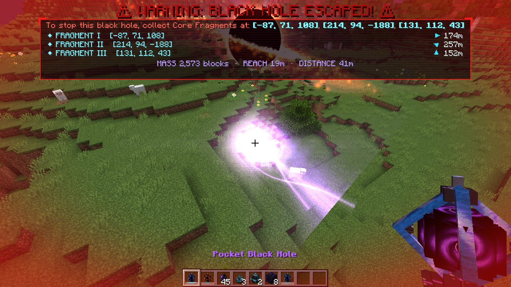
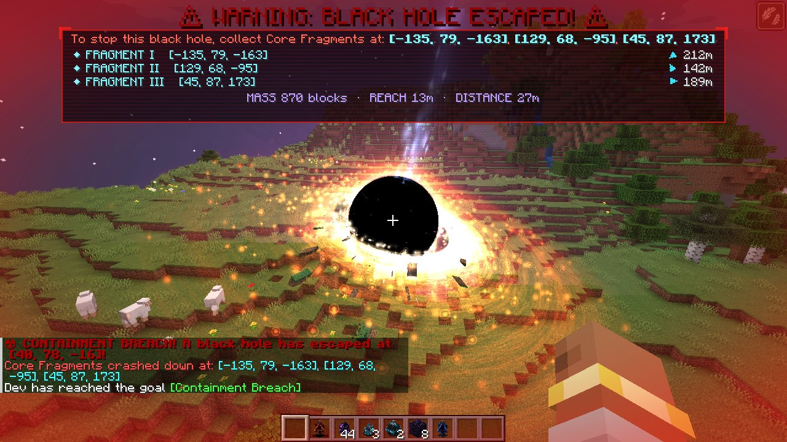
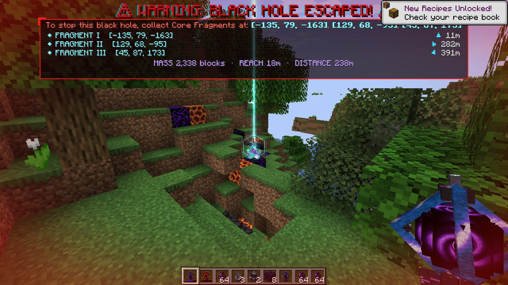
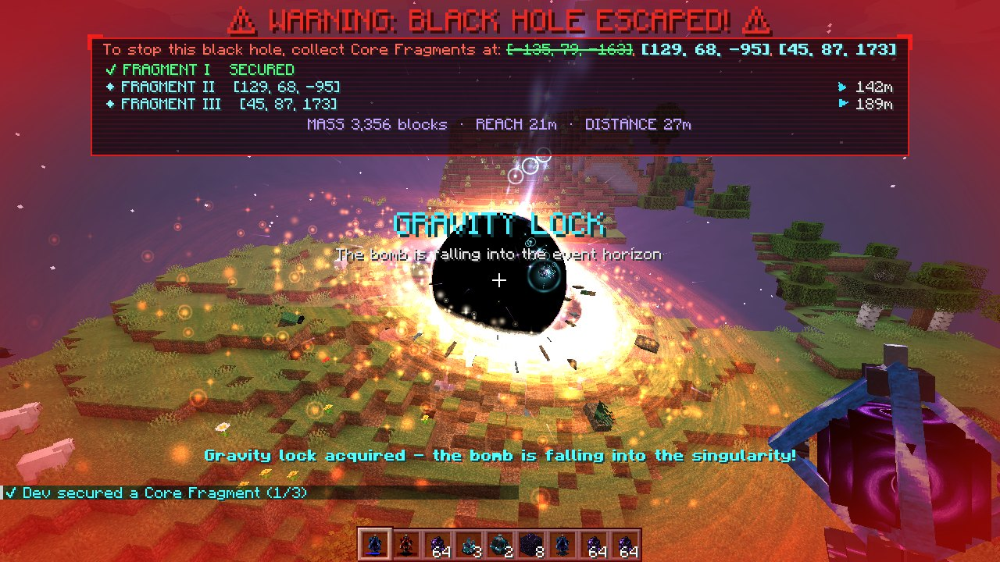
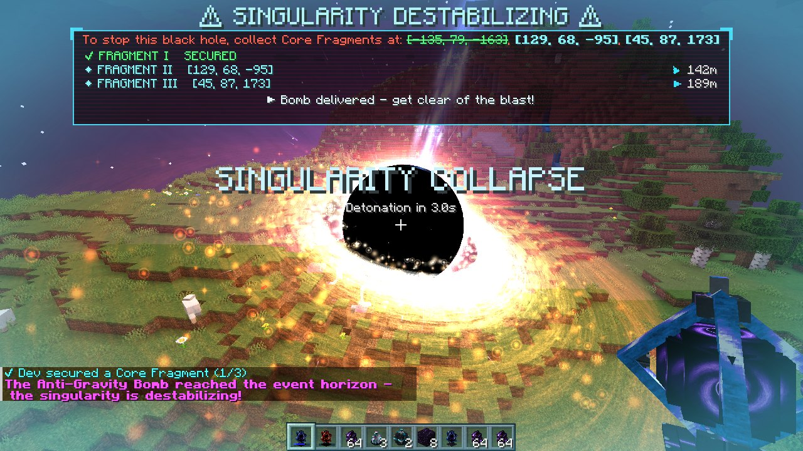
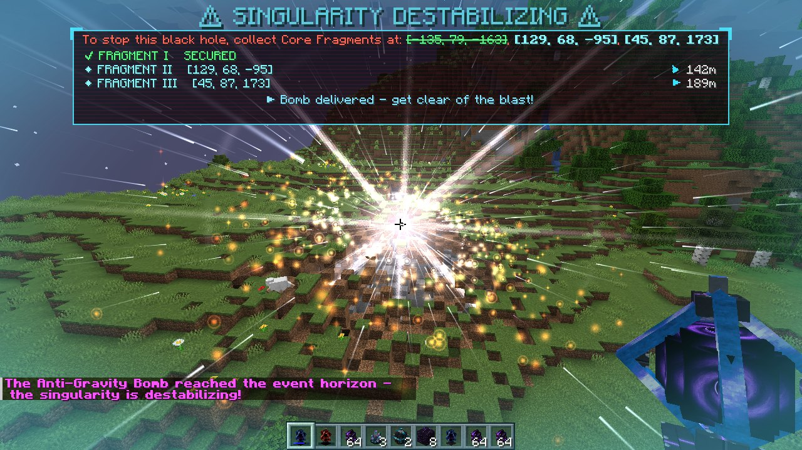
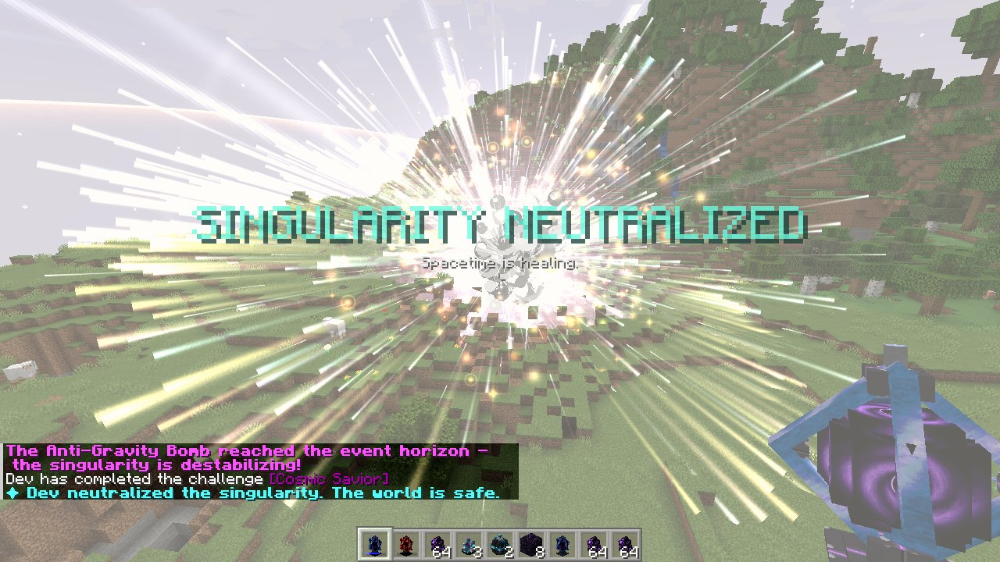
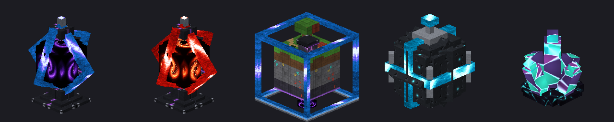

# Living Black Hole

A cinematic singularity event for **Minecraft 1.20.1 (Forge 47.x)**.

The Pocket Black Hole swallows whole 16×16×16 chunks of the world (a house, a hill, a lake) into Compressed Chunks you can paste back anywhere. Feed it ten and its containment fails. A living black hole tears the world apart and drags everything toward it, you included, while three Core Fragments crash down within 300 blocks. Recover them, forge an Anti-Gravity Bomb, and throw it into the event horizon before there is nothing left to save.

**Download:** grab `LivingBlackHole-2.0.0-forge-1.20.1.jar` from the [latest release](https://github.com/ananttomar232-tech/Black-hole-mod/releases/latest) and drop it into `.minecraft/mods`.

Every release is built by CI, then played end to end on a dedicated server and in a real client before it is published. Screenshots from the latest automated run are attached to the [`ci-evidence` release](https://github.com/ananttomar232-tech/Black-hole-mod/releases/tag/ci-evidence).

## Gallery
Captured automatically by the CI client self-test (software rendering, default settings):

| | |
|---|---|
|  |  |
| *The Pocket Black Hole's consumption beam* | *The escaped singularity devouring the hills, HUD tracking the three fragments* |
|  |  |
| *A Core Fragment crash site with its sky beam* | *Gravity lock: the Anti-Gravity Bomb falls into the horizon* |
|  |  |
| *Destabilisation: white-hot disk, countdown to detonation* | *Implosion and detonation flare* |
|  | |
| *The shockwave: singularity neutralized* | |


*Pocket Black Hole (stable / critical), Compressed Chunk, Anti-Gravity Bomb, Core Fragment.*

---

## The event, step by step

### 1. The Pocket Black Hole
Crafted from crying obsidian, amethyst shards and an eye of ender:

```
C A C      C = Crying Obsidian
A E A      A = Amethyst Shard
C A C      E = Eye of Ender
```

- **Right-click any block** and the singularity swallows the **16×16×16 region centred on it**: a house, a mountain top, a lake. Matter whirls down a swirling vortex into the device with a vacuum roar, leaving a perfect cube-shaped hole in the world.
- Everything taken is stored in the NBT of a new **Compressed Chunk** item in your inventory: block states, positions *and* block-entity data, so chests keep their contents and signs keep their text. Nothing drops. A 3D miniature of a voxel world in a glowing cage marks it, and its tooltip lists what's inside and where it came from.
- **Right-click a surface with a Compressed Chunk** to unfold it. The structure lands exactly as it was taken (the block you originally clicked lands on the block you click now), and the item is used up. Anyone standing inside is lifted clear instead of suffocating.
- Both directions respect spawn protection and claim mods (`BlockEvent.BreakEvent`). Bedrock, end portals and Core Fragments are never taken or overwritten.
- The durability bar shows **containment integrity** (cyan → violet → red). The 3D model escalates through stable, unstable and critical states, the device leaks sparks as it fills, and warnings fire at 50%, 80% and 90%.
- **Hidden limit: 10 chunks.**

### 2. Containment breach
When the 10th chunk goes in:
- The Pocket Black Hole is **deleted** from your inventory.
- A **Living Black Hole** spawns exactly where you stand. The breach throws you clear, with slow falling and resistance so you survive.
- **Three Core Fragments** crash down at random surface coordinates within 300 blocks, each in a scorched crater with a sky beam you can see from far away.
- Alarms sound, the screen glitches and flashes red, and a **permanent HUD** appears with flashing red text:
  > **⚠ WARNING: BLACK HOLE ESCAPED! ⚠**
  > To stop this black hole, collect Core Fragments at: [x, y, z], [x, y, z], [x, y, z]

  The HUD also gives a live distance and compass arrow for every fragment, ticks them off as they are secured, and shows the singularity's mass, reach and distance. It survives relogs, deaths and dimension changes, and only disappears once the black hole is destroyed.

### 3. The Living Black Hole
- It never moves, but it **devours every block within a 30-block radius**, nearest matter first, its reach growing as it feeds. Torn-out blocks become **gravitational debris**: real entities that tumble, glow red-hot and stretch (spaghettify) as they spiral across the horizon.
- **Everything is pulled toward it, players included.** Mobs and items are dragged in and destroyed. Players feel a constant, gentle drag toward the centre, from a slight lean at the 30-block edge to roughly walking speed next to the core: walking away barely holds ground, **sprinting always escapes**. The pull is weaker in the air so jumps don't turn into launches. Flying into the horizon itself is fatal.
- Rendering, in layers:
  - a pitch-black event horizon
  - a Doppler-beamed accretion disk with Keplerian differential rotation
  - a photon ring and lensed far-side arcs that track the spin axis
  - relativistic jets and a corona
  - thousands of orbiting plasma particles
  - a **screen-space gravitational lensing shader** that bends the world behind the hole, with an Einstein ring, chromatic dispersion, frame-dragging swirl and heat shimmer, while foreground blocks stay crisp
- The sky dims to violet and the stars come out near it, even at noon. The camera trembles and its roar fills the air.

### 4. The Anti-Gravity Bomb
Mine the three Core Fragments with any tool (they always drop, never despawn and survive lava), then craft:

```
3 × Core Fragment + 1 × Compressed Chunk  →  Anti-Gravity Bomb   (shapeless)
```

The bomb has a glowing emissive 3D model and sheds sparks that fall *upward* while held.

### 5. The climax
Throw the bomb anywhere within **40 blocks** of the black hole. Its gravity seizes the bomb, ignoring walls and water, and spirals it into the centre. Then:
1. **Destabilisation:** the horizon swells and flickers, the disk spins up and turns white-blue, a countdown appears on the HUD, and a Shepard-tone whine rises.
2. **Implosion:** everything collapses to a single point.
3. **Detonation:** a deafening custom explosion plays for every player in the dimension, followed by a full-screen white flash, violent camera shake and a colossal Fresnel shockwave shell with disk-plane rings racing outward 150+ blocks.
4. The black hole is gone, the destruction stops, the HUD clears into *SINGULARITY NEUTRALIZED*, and a burst of experience rains down.

---

## Extras
- **Advancement tree:** Living Black Hole → Pocket Dimension → Containment Breach → Shards of Creation → Phase Inversion → *Cosmic Savior* (challenge).
- **Explosions inside a black hole's reach are swallowed:** they hurt nothing and destroy no blocks.
- **Chunk loading:** the singularity keeps its own chunk ticking, so it keeps eating while you are away (configurable).
- **Multiplayer-ready:** every player sees the HUD, and all players near the collapse are credited.
- **Custom death message:** *"Steve was spaghettified by a black hole"*.

## Commands (operators)
| Command | Effect |
|---|---|
| `/blackhole list` | Every active singularity, its mass and fragment status |
| `/blackhole spawn [pos]` | Start a full escape event (fragments included) |
| `/blackhole neutralize` | Collapse the nearest black hole with the full cinematic |
| `/blackhole clear` | Instantly remove all black holes and clear the HUD |
| `/blackhole charge <chunks>` | Set how many chunks the held Pocket Black Hole has swallowed |

The creative tab also includes a Pocket Black Hole one chunk away from breaching.

## Configuration
`config/livingblackhole-common.toml`: chunk limit, cooldown, suction radius, devour rate, debris cap, block destruction toggle, chunk loading, entity pulling, player pull strength, fragment radius and minimum distance, bomb capture radius, experience reward.

`config/livingblackhole-client.toml`: lensing on/off and strength, screen shake, particle density, sky darkening, full-screen flashes (photosensitivity).

## Building from source
Requires JDK 17.

```bash
./gradlew build
```

The jar is written to `build/libs/`. Run the automated end-to-end tests locally with:

```bash
./gradlew runServer -Pselftest
```

```bash
./gradlew runClient -Pselftest
```

All art and audio are generated procedurally and can be regenerated with Python 3, numpy, Pillow and ffmpeg:

```bash
python3 tools/generate_textures.py
```

```bash
python3 tools/generate_sounds.py
```

```bash
python3 tools/generate_data.py
```

## License
MIT. See [LICENSE](LICENSE).
